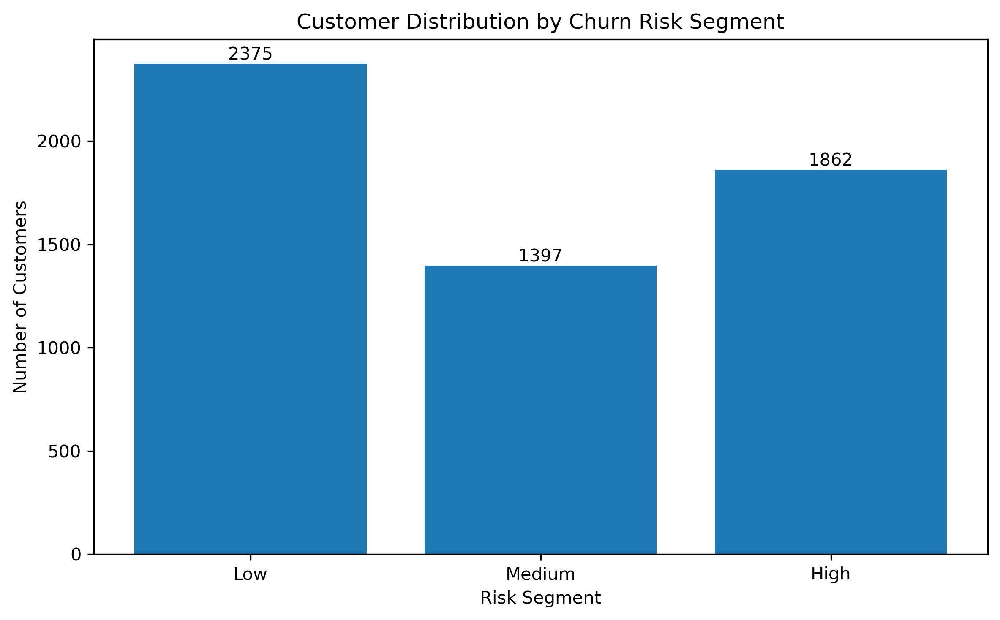
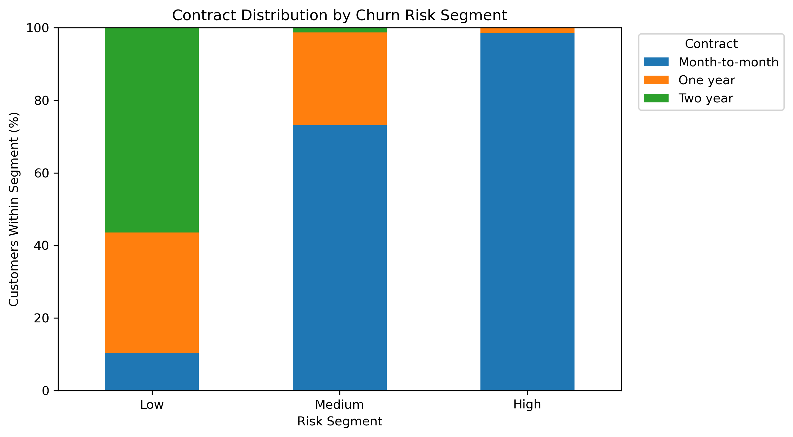
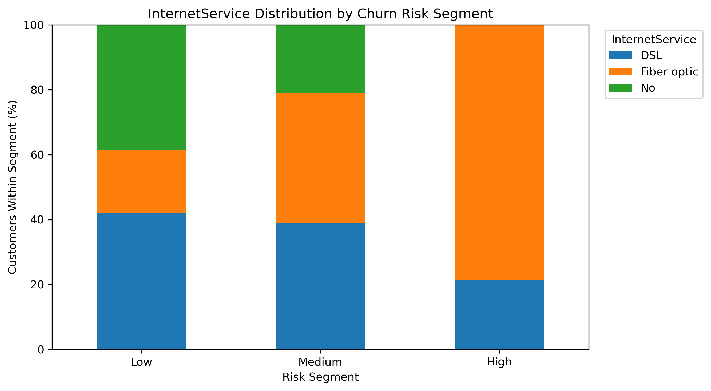
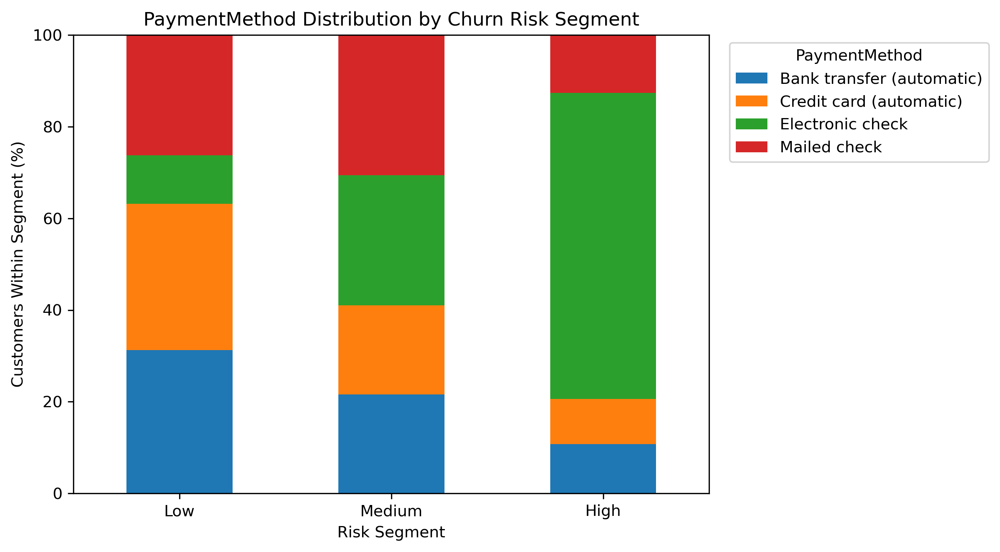
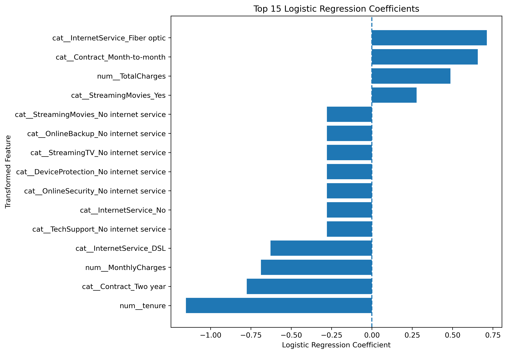
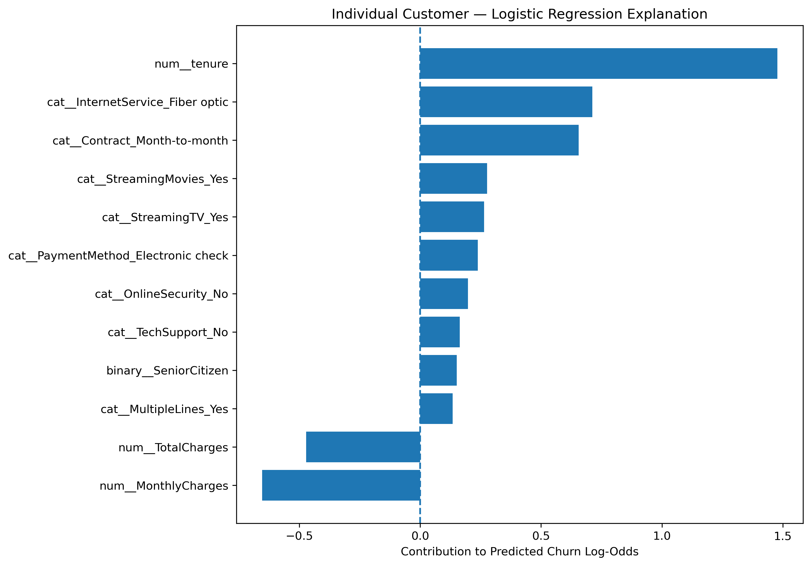

# Secondary Lens: High-Risk Customer Profiling and Explainability

**Project:** Telco Customer Churn Prediction  
**Contributor:** Hari (Member 1)  
**Implementation:** [`notebooks/09_high_risk_profiling.ipynb`](../notebooks/09_high_risk_profiling.ipynb)

## 1. Objective and scope

The secondary lens extends the project's primary churn-classification work by examining **which customers the selected model scores as higher risk**, identifying their common characteristics, explaining model predictions, and proposing retention actions for later business evaluation.

This work **does not train or select a new model**. It uses the previously selected class-weighted Logistic Regression pipeline, with a **fixed classification threshold of 0.60**, on the original training features. It is a descriptive, model-based analysis—not an independent evaluation of predictive performance or evidence of what causes churn.

## 2. Data and methodology

The notebook loads the trusted fitted model (`models/selected_churn_model.joblib`), its configuration (`models/selected_model_config.joblib`), `data/processed/X_train_raw.csv`, and `data/processed/y_train.csv`.

- **Profiling sample:** 5,634 training customers, with 19 original input features.
- **Risk score:** output of the selected pipeline's `predict_proba(X_train)[:, 1]`.
- **Binary classification:** score **≥ 0.60** indicates a predicted churn case.
- **Descriptive segments:** Low **< 0.30**; Medium **≥ 0.30 and < 0.60**; High **≥ 0.60**.
- **Group profiling:** within-segment percentages for contract, internet service, payment method, online security, technical support, and paperless billing, together with mean tenure and monthly charges.
- **Global explainability:** fitted Logistic Regression coefficients for 45 preprocessed features.
- **Local explainability:** each transformed customer feature multiplied by its coefficient, with the intercept, to reconstruct the prediction in log-odds space.

The **0.30 segmentation boundary is an analytical choice**; it has not been validated as a business intervention cutoff. The 0.60 threshold comes from the earlier model-selection process and is reused unchanged here.

## 3. Risk segmentation results

| Risk segment | Model score range | Customers | Share | Mean score | Mean tenure (months) | Mean monthly charges |
|---|---|---:|---:|---:|---:|---:|
| Low | < 0.30 | 2,375 | 42.16% | 0.110 | 49.10 | 55.62 |
| Medium | 0.30 to < 0.60 | 1,397 | 24.80% | 0.449 | 27.58 | 63.05 |
| High | ≥ 0.60 | 1,862 | 33.05% | 0.775 | 14.97 | 78.21 |
| **Total** | | **5,634** | **100.00%** | | | |

The high-score group has markedly shorter average tenure and higher average monthly charges than the low-score group. These are characteristics **associated with model scores** within the training sample, not demonstrated drivers of churn.

## 4. Customer characteristics by segment

Selected within-segment comparisons:

| Characteristic | Low risk | Medium risk | High risk |
|---|---:|---:|---:|
| Month-to-month contract | 10.32% | 73.09% | **98.60%** |
| Two-year contract | 56.46% | 1.29% | **0.00%** |
| Fiber optic internet | 19.33% | 40.01% | **78.68%** |
| Electronic check payment | 10.57% | 28.42% | **66.76%** |

The clearest model-defined high-risk profile combines **short tenure**, **month-to-month service**, **fiber optic internet**, and **electronic check payment**. The customer groups were generated using the same model that incorporates these characteristics; therefore, the pronounced separation is partly expected and **should not be presented as an independent discovery or causal proof**.

### Visual profiles

**Contract type**

**Internet service**

**Payment method**

Additional profile tables for online security, technical support and paperless billing are included in [`risk_segment_profiles.csv`](../reports/risk_segment_profiles.csv).

## 5. Global model explainability

The selected fitted Logistic Regression model contains **45 transformed feature coefficients**. The largest reported coefficients by absolute value include:

| Transformed feature | Coefficient | Conditional interpretation |
|---|---:|---|
| `num__tenure` | -1.1526 | Higher standardized tenure lowers predicted log-odds |
| `cat__Contract_Two year` | -0.7759 | A two-year indicator contributes negatively |
| `cat__InternetService_Fiber optic` | +0.7124 | The fiber optic indicator contributes positively |
| `num__MonthlyCharges` | -0.6877 | Higher standardized charges have a negative *conditional* coefficient |
| `cat__Contract_Month-to-month` | +0.6560 | A month-to-month indicator contributes positively |
| `cat__InternetService_DSL` | -0.6278 | The DSL indicator contributes negatively |
| `num__TotalCharges` | +0.4873 | Higher standardized total charges have a positive *conditional* coefficient |

Coefficients operate on **log-odds**, not percentage-point changes in churn probability. Numeric inputs were standardized and categorical inputs one-hot encoded; coefficients are not uniformly comparable as raw feature importances. The negative conditional coefficient for monthly charges is not inconsistent with higher **unadjusted average charges** in the high-risk segment because the inputs are correlated. Multiple `No internet service` indicators overlap and can share fitted effects. No coefficient should be interpreted causally.

## 6. Individual customer explanation

To illustrate a local explanation, the notebook selected the **highest-scoring training row (index 1615)**:

| Attribute | Recorded value |
|---|---|
| Tenure | 1 month |
| Contract | Month-to-month |
| Internet service | Fiber optic |
| Monthly charges | 93.55 (dataset units) |
| Online security | No |
| Technical support | No |
| Model score | **0.9387** |
| Fixed classification threshold | **0.60** |

Top contributors to the predicted churn **log-odds**, not directly to probability:

| Contribution | Value |
|---|---:|
| Short tenure (`num__tenure`, standardized) | +1.4772 |
| Fiber optic indicator | +0.7124 |
| Month-to-month indicator | +0.6560 |
| Monthly charges (standardized) | -0.6531 |
| Total charges (standardized) | -0.4716 |
| Streaming movies: Yes | +0.2768 |
| Streaming TV: Yes | +0.2641 |
| Electronic check payment | +0.2389 |
| Online security: No | +0.1980 |
| Technical support: No | +0.1640 |

The notebook verifies numerically that **intercept + sum of all 45 feature contributions** reproduces the classifier's log-odds and, after applying the logistic function, its risk score. The selected row is deliberately extreme and is **not representative of the full high-risk group**. Its score of 0.9387 is **not a verified 93.87% real-world churn probability**.

## 7. Proposed retention strategies

| Segment | Suggested priority | Proposed action | Reason for consideration |
|---|---|---|---|
| High | High | Personalized contact; review billing, service, support and suitable contract options | Focus limited retention resources on customers with higher model-estimated risk |
| Medium | Medium | Proactive support, service-quality follow-up and relevant loyalty communication | Address concerns early while keeping outreach proportionate |
| Low | Low | Continue reliable service, regular communication and appropriate loyalty benefits | Maintain customer experience without disproportionate intervention expenditure |

These are **proposals**, not proven churn-reduction treatments. Any rollout should evaluate eligibility, contact cost, customer experience, treatment response and incremental business value. A controlled trial or other suitable evaluation is needed before claiming that interventions improve retention.

## 8. Limitations and safeguards

1. **In-sample profiling:** Scores and segments were generated for the same training records used to fit the model. Segment statistics are descriptive, not out-of-sample evidence of generalization.
2. **Calibration:** The final evaluation identified imperfect probability calibration for the class-weighted Logistic Regression model. Scores should be treated as **relative model risk indicators**, not precise individual churn probabilities.
3. **Non-causality:** Group composition, fitted coefficients and local feature contributions describe model behavior and statistical associations; none establish that a feature causes churn or that changing it will reduce churn.
4. **Correlated and duplicated encodings:** Standardized billing variables and correlated one-hot service indicators complicate coefficient-level explanations.
5. **Thresholds:** The 0.60 classification threshold was frozen during the previous model-selection workflow. The Low/Medium/High descriptive split does not constitute a separately validated decision policy.
6. **Illustrative local case:** The highest-risk training row was chosen intentionally as an explanation example, not as a typical customer.
7. **Holdout integrity:** The secondary lens does not reselect the classifier, change the frozen threshold, or use final test outcomes to optimize segmentation or retention actions. The project's final held-out evaluation is covered separately in Notebook 8; the broader project should disclose any earlier inadvertent exposure of held-out data during exploratory work.
8. **Operational deployment:** No calibration adjustment, retention trial, deployment, drift assessment or fairness audit was performed by this notebook.

## 9. Generated artifacts

All paths are relative to the repository root:

| Artifact | Purpose |
|---|---|
| `notebooks/09_high_risk_profiling.ipynb` | Reproducible analysis notebook |
| `reports/customer_risk_profiles.csv` | Per-training-customer features, observed label, model score, prediction and segment |
| `reports/risk_segment_summary.csv` | Segment counts, percentages and numeric summaries |
| `reports/risk_segment_profiles.csv` | Category distributions across segments |
| `reports/risk_segment_distribution.png` | Counts by risk segment |
| `reports/risk_profile_contract.png` | Contract breakdown |
| `reports/risk_profile_internetservice.png` | Internet service breakdown |
| `reports/risk_profile_paymentmethod.png` | Payment method breakdown |
| `reports/churn_feature_explanations.csv` | Fitted model coefficients and directions |
| `reports/churn_feature_importance.png` | Top coefficient magnitudes and signs |
| `reports/individual_customer_explanation.csv` | Feature-level local log-odds contributions |
| `reports/individual_customer_explanation.png` | Local explanation chart |
| `reports/retention_recommendations.csv` | Proposed segment-based business responses |

The notebook also requires **locally available** trusted model artifacts and prepared training data. These are inputs, not files that must be committed to a public repository. Handle customer-level extracts in accordance with project data-sharing rules.

## 10. Conclusion

The secondary lens translates the selected Telco Customer Churn model into interpretable **risk-based customer profiles**, documents dominant model associations, and provides an exact example of an individual Logistic Regression explanation. The 1,862 high-scoring training customers are disproportionately short-tenure, month-to-month, fiber optic and electronic-check customers. These patterns can inform hypotheses for retention outreach but **cannot, by themselves, validate an intervention or estimate its causal benefit**.
